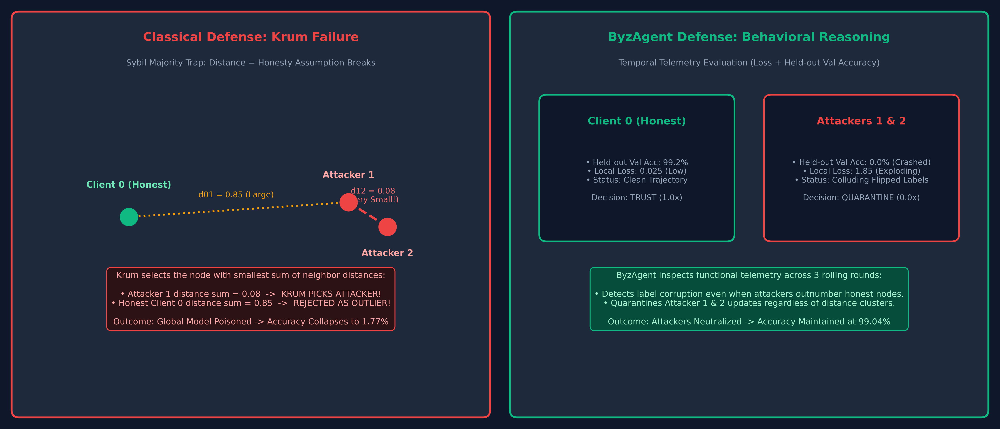
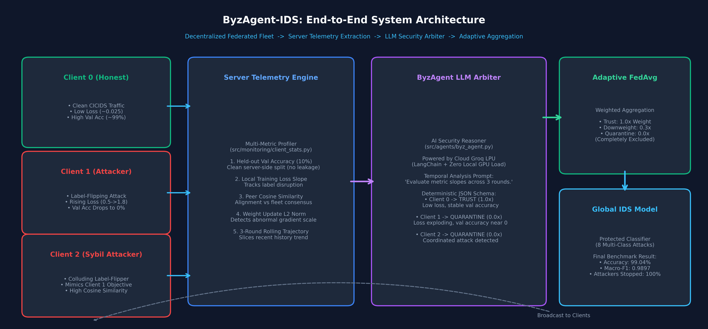
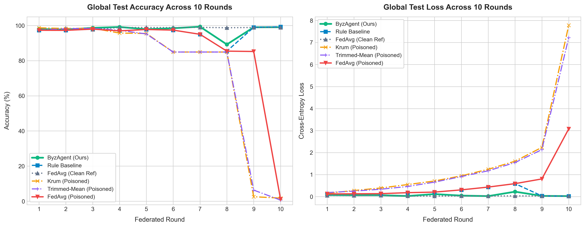
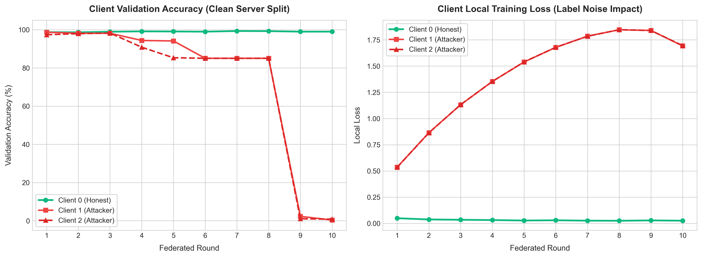
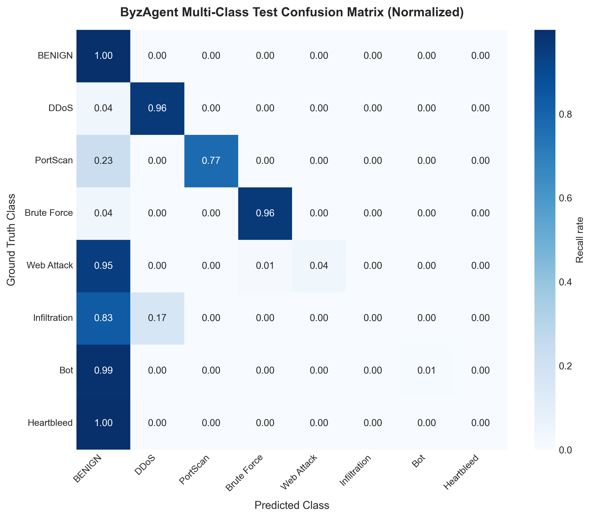

# ByzAgent-IDS: Agentic Byzantine Trust Diagnosis for Federated Intrusion Detection

<div align="center">

[](https://www.python.org/)
[](https://pytorch.org/)
[](https://www.langchain.com/)
[](https://groq.com/)
[](https://www.unb.ca/cic/datasets/ids-2017.html)
[](https://vitejs.dev/)

**An LLM-as-a-Security-Arbiter that prevents Sybil poisoning in Federated Learning by diagnosing client telemetry instead of relying on broken geometric formulas.**

[Overview](#-overview) • [The Problem: Why Krum Fails](#-the-problem-why-classical-defenses-fail) • [Architecture](#-architecture) • [Experimental Results](#-empirical-benchmark-results) • [Quickstart](#-quickstart--reproduction) • [Dashboard](#-interactive-dashboard)

</div>

---

## 📌 Overview

Federated Learning (FL) allows distributed organizations (e.g., banks, hospitals, enterprise networks) to collaboratively train an Intrusion Detection System (IDS) without ever sharing their raw network traffic logs. 

However, FL is acutely vulnerable to **Byzantine attacks**: compromised or malicious participants can upload poisoned model updates (such as label-flipping attacks) designed to corrupt the global detector.

### The Core Question
> *"What happens when attackers form a colluding majority ($f \ge n/2$)? Can an LLM reason over behavioral telemetry to catch poisoned clients that fool traditional algorithms?"*

**ByzAgent-IDS** replaces static geometric distance formulas with an **LLM Security Arbiter** powered by LangChain and Groq. Each training round, the server extracts multi-dimensional behavioral telemetry from each client (local loss, held-out server validation accuracy, peer cosine similarity, weight update norms) across a 3-round rolling history. ByzAgent inspects these temporal trends to output an auditable three-way decision: **`TRUST`**, **`DOWNWEIGHT`**, or **`QUARANTINE`** with a natural-language rationale.

---

## 💥 The Problem: Why Classical Defenses Fail

Classical Byzantine-robust aggregators such as **Krum** (Blanchard et al., NeurIPS 2017) and **Coordinate-wise Trimmed-Mean** operate under a strict theoretical assumption: **honest clients must form a strict majority ($n > 2f + 2$)**.

<div align="center">
  
</div>

### The Sybil Collapse:
1. **Attackers Collude:** Attackers 1 and 2 flip labels to poison the model. Because they execute the same objective, their weight vectors point in a similar direction ($d_{12}$ is very small).
2. **Krum Computes Distances:** Krum calculates Euclidean distances between all pairs of client models and selects the single client closest to its nearest neighbors.
3. **The Result:** The distance between the two attackers ($d_{12}$) is much smaller than the distance to the honest client ($d_{01}$). **Krum declares an attacker to be the most "representative" client and discards the honest update.**
4. **Catastrophic Failure:** Global model accuracy plummets from **98.92% down to 1.77%**.

---

## 🛡️ The ByzAgent Solution

Instead of assuming distance equals honesty, ByzAgent evaluates **behavioral cause-and-effect** across time:

<div align="center">
  
</div>

### Telemetry Signals Evaluated by ByzAgent:
1. **Held-out Server Validation Accuracy:** Evaluated on a clean server-side split (10% slice of CICIDS-2017, completely isolated from test data). Poisoned models show sharp drops here.
2. **Local Training Loss:** Poisoned clients trying to learn contradictory flipped labels show sustained or rising training loss.
3. **Peer Cosine Similarity:** Quantifies alignment with the fleet consensus vector.
4. **Weight Update Norm ($L_2$):** Detects gradient scaling anomalies.
5. **Rolling History Trajectory:** Slices the last 3 rounds so the LLM evaluates slopes (gradual degradation) rather than static point-in-time noise.

---

## 📊 Empirical Benchmark Results

All experiments were executed on the full **CICIDS-2017** benchmark (1,786,531 training flows, 446,633 test flows, 8 balanced traffic classes) under identical conditions: **3 clients, 2 colluding gradual label-flipping attackers, 10 federated rounds**.

### Benchmark Summary Table

| Defense Strategy | Attack Status | Final Accuracy | Macro-F1 | Attacker Detections (TP) | False Alarms (FP) | Final Verdict |
| :--- | :--- | :---: | :---: | :---: | :---: | :--- |
| **FedAvg (Clean Reference)** | No Attack | **98.92%** | **0.9882** | — | — | Theoretical upper bound. |
| **FedAvg (Poisoned)** | Gradual Flip | **1.18%** | **0.0156** | 0 | 0 | **Total collapse**: Attacker weights poison the network. |
| **Krum (Poisoned)** | Gradual Flip | **1.77%** | **0.0296** | 0 | 0 | **Total collapse**: Tricked by Sybil cluster every round. |
| **Trimmed-Mean (Poisoned)** | Gradual Flip | **0.64%** | **0.0051** | 0 | 0 | **Total collapse**: Malicious coordinates dominate median. |
| **Rule-Based Baseline** | Gradual Flip | **99.33%** | **0.9926** | 4 / 20 | 1 | **Delayed**: Only caught attacks at round 9–10 after full collapse. |
| **ByzAgent (Ours)** | Gradual Flip | **99.04%** | **0.9897** | **20 / 20** | **2** | **Full Defense**: Caught attackers in early rounds via temporal reasoning. |

---

### Visual Comparison

#### 1. Convergence & Defense Comparison
Krum, Trimmed-Mean, and standard FedAvg collapse to near 0% as poisoning escalates. ByzAgent maintains stability on par with the unpoisoned reference:

<div align="center">
  
</div>

#### 2. Client Telemetry Trajectory (The LLM's View)
Notice how Client 0 (green) maintains high validation accuracy and low loss, whereas Attackers 1 & 2 (red) exhibit escalating loss and plunging validation accuracy:

<div align="center">
  
</div>

#### 3. 8-Class Multi-Class Confusion Matrix (ByzAgent Protected Model)
Evaluated on 401,970 held-out test flows across all 8 intrusion categories:

<div align="center">
  
</div>

---

## 🧠 Sample ByzAgent Reasoning Log

Here are actual decisions generated by the LLM during training rounds:

```json
[
  {
    "round": 4,
    "decisions": [
      {
        "client_id": "client_0",
        "decision": "trust",
        "explanation": "Decreasing loss, rising val_accuracy and stable norms despite modest cos_sim drop indicate normal behavior."
      },
      {
        "client_id": "client_1",
        "decision": "quarantine",
        "explanation": "Steady loss increase, val_accuracy drop to 0.94 and falling cos_sim suggest clear poisoning."
      },
      {
        "client_id": "client_2",
        "decision": "quarantine",
        "explanation": "Loss rising, val_accuracy fell to 0.91 and cos_sim decreasing indicate strong divergence."
      }
    ]
  }
]
```

---

## 💻 Interactive Dashboard

The repository includes a modern React + Vite dashboard with interactive Recharts visualizations:
* **Live Demo:** Real-time replay of packet classification from held-out test traffic.
* **Agent Reasoning Log:** Audit trail of ByzAgent's natural-language rationales per round.
* **Telemetry Inspector:** Interactive charts of client loss, cosine similarity, and validation accuracy.
* **Analytics:** 8x8 Confusion Matrix heatmap and per-class precision/recall metrics.

> **Tip for Deployment:** The frontend reads static pre-compiled experiment results from `dashboard/public/data/` and can be deployed directly to **Vercel** with zero backend infrastructure needed.

---

## 🚀 Quickstart & Reproduction

### 1. Prerequisites
* Python 3.10 or higher
* Node.js 18+ (for dashboard)
* Free Groq API Key (get one at [console.groq.com](https://console.groq.com/))

### 2. Environment Setup
```bash
# Clone the repository
git clone https://github.com/samyashwanth7/ByzAgent-IDS.git
cd ByzAgent-IDS

# Install Python dependencies
pip install -r requirements.txt

# Create your .env file
echo GROQ_API_KEY=your_groq_api_key_here > .env
```

### 3. Dataset Preprocessing
Ensure the CICIDS-2017 CSV files are in `data/raw/` or run the automated preprocessor:
```bash
python src/dataset.py
```
*(Caches preprocessed features to `data/processed/cicids2017_multiclass.pkl`)*

### 4. Run the Full Experiment Benchmark
To execute the complete benchmark suite (FedAvg, Krum, Trimmed-Mean, Rule, ByzAgent):
```bash
python experiments/run_all.py
```
Or run individual strategies:
```bash
# Run ByzAgent defense
python experiments/run_federated.py --strategy byzagent

# Run Krum baseline
python experiments/run_federated.py --strategy krum

# Run Rule baseline
python experiments/run_federated.py --strategy rule
```

### 5. Launch the Dashboard
```bash
cd dashboard
npm install
npm run dev
```
Open your browser at `http://localhost:5173`.

---

## 📂 Repository Structure

```
ByzAgent-IDS/
├── config.py                 # Central experiment parameters & thresholds
├── src/
│   ├── model.py              # PyTorch MLP Intrusion Detection Architecture
│   ├── dataset.py            # CICIDS-2017 multi-class parser & split generator
│   ├── utils.py              # Training loops, evaluation, device handlers
│   ├── attacks/
│   │   └── label_flip.py     # Sudden & gradual label-flipping poison simulator
│   ├── monitoring/
│   │   └── client_stats.py   # Client telemetry extractor (norms, cos_sim, loss)
│   ├── aggregation/
│   │   └── robust_baselines.py # Krum and Trimmed-Mean aggregators
│   └── agents/
│       └── byz_agent.py      # LLM Security Arbiter (LangChain + Groq)
├── experiments/
│   ├── run_federated.py      # Main federated training loop
│   └── run_all.py            # Automated benchmark runner suite
├── scripts/
│   ├── export_frontend_data.py   # Compiles experiment outputs to frontend JSON
│   └── generate_readme_figures.py # Plots publication figures for documentation
├── dashboard/                # React + Vite + Tailwind + Recharts Web UI
│   ├── public/data/          # Real experimental JSON datasets
│   └── src/                  # React dashboard components
└── results/                  # Real experimental metric JSONs & model weights
```

---

## 🎓 Viva & Interview Defense Q&A

<details>
<summary><b>Q1: Why use an LLM instead of standard statistical outlier detection?</b></summary>
<br>
Geometric outlier detectors (Krum, Trimmed-Mean, Bulyan) assume distance from the mean correlates with malice. When attackers form a majority ($f \ge n/2$), the statistical "outlier" is actually the honest node. ByzAgent inspects semantic relationships—evaluating local loss relative to validation accuracy on a clean server set across multiple rounds—which reveals contradictory learning regardless of fleet proportions.
</details>

<details>
<summary><b>Q2: Does ByzAgent require expensive GPU infrastructure to run?</b></summary>
<br>
No. ByzAgent executes only <b>one prompt per round</b> (batching all clients into a single JSON schema). By utilizing Groq's cloud LPU, inference latency is under 1.5 seconds per round at virtually zero cost.
</details>

<details>
<summary><b>Q3: What prevents data leakage in the validation set?</b></summary>
<br>
We strictly isolate a 10% server validation slice (44,663 flows) evaluated only by the arbiter, completely separate from the 401,970 test flows used exclusively for final global model metrics.
</details>

---

## 👥 Authors & Acknowledgments

* **Sampath Kumar & Team** — VIT-AP University, 2026.
* Built as a Capstone Project in Federated Learning & LLM-Driven Security Automation.
